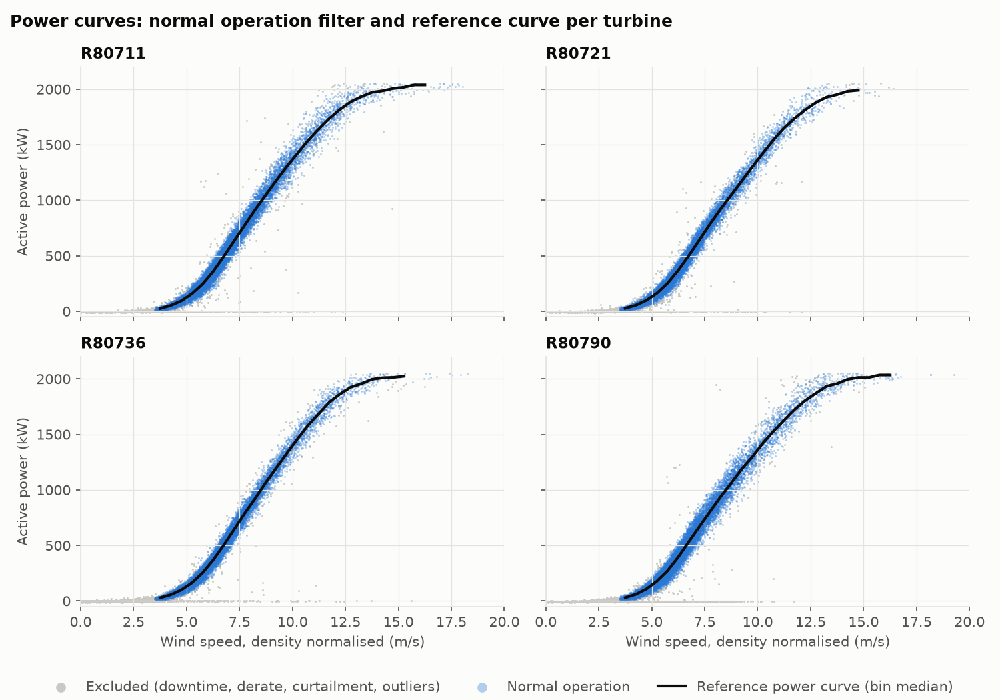
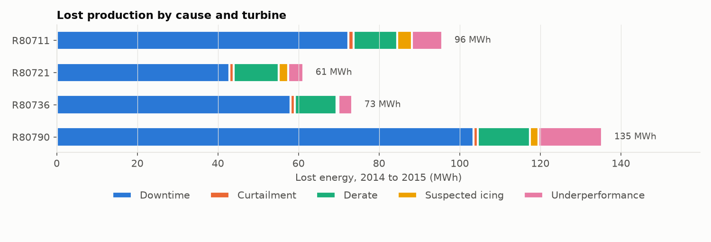
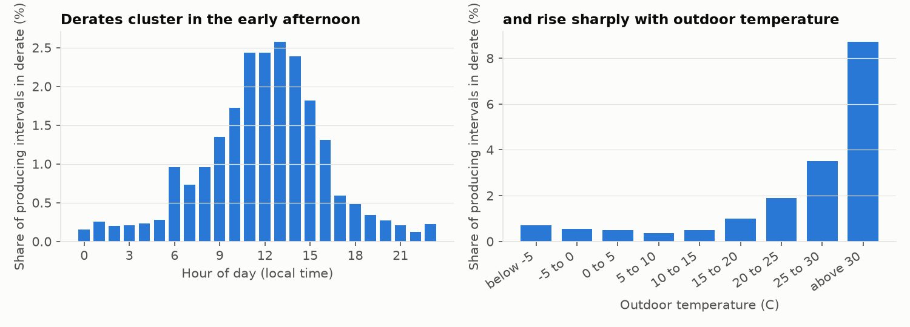
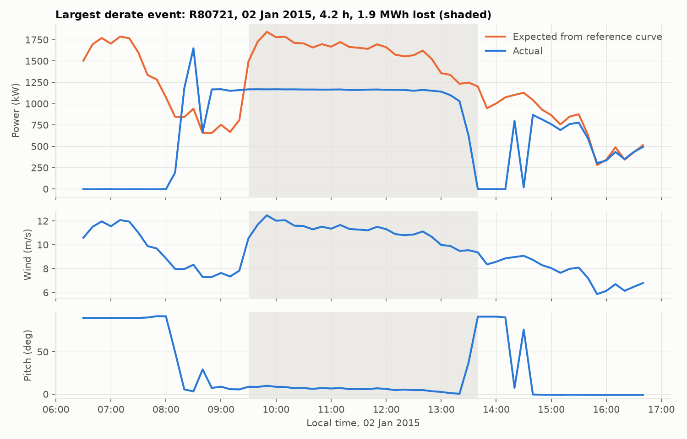
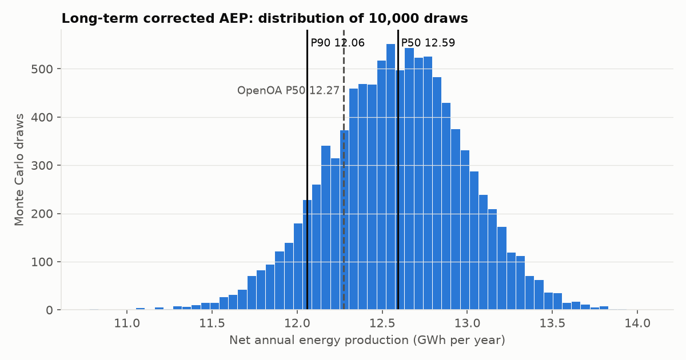

# Wind farm SCADA performance analytics

Operational performance review of the La Haute Borne wind farm (four Senvion MM82 turbines, 8.2 MW, north-eastern France) from two years of 10-minute SCADA data: power curves, lost production by cause, recurring derate diagnosis, electrical losses and a long-term corrected annual energy estimate with P50 and P90 values.

**[Open the interactive dashboard](https://onyichuks.github.io/wind-scada-performance-analytics/)** to filter by turbine, period and derate threshold, browse derate events and explore the energy estimate.



## Key results (2014 to 2015)

| Measure | Result |
|---|---|
| Valid SCADA intervals | 99.38 percent of 420,480 |
| Lost production | 366 MWh, 1.46 percent of potential (downtime 277, derate 45, underperformance 30, suspected icing 9, curtailment 5) |
| Energy-based availability | 98.89 percent; lowest turbine R80790 at 98.39 percent |
| Check against operator records | Downtime estimate is 90 percent of the plant-reported availability loss (277 vs 308 MWh) |
| Electrical losses, turbines to revenue meter | 2.09 percent |
| Recurring derates | 8.7 percent of producing intervals above 30 C were derated, against 0.5 percent at 10 to 15 C, peaking in summer early afternoons: the signature of thermal protection |
| Long-term net AEP | **P50 12.59 GWh per year** (capacity factor 17.5 percent); P90 one-year 11.15, ten-year 11.92 |
| Independent validation | NREL OpenOA P50 on the same data: 12.27 GWh per year (2.6 percent difference) |

The full write-up, with findings and limitations, is in [docs/METHOD.md](docs/METHOD.md). The dataset, its source, licence, columns and known issues are described in [docs/DATASET.md](docs/DATASET.md).

## What the analysis does

1. **Data quality checks.** UTC conversion, removal of daylight saving duplicates, missing and out-of-range flags, frozen anemometer detection, blanking of sensor fault codes. Missing intervals stay visible so availability is not overstated.
2. **Power curves.** Air density normalisation of wind speed (cube-root rule for pitch-regulated turbines, ERA5 density), a normal operation filter (production, no plant losses, normal pitch for the wind speed, robust outlier band) and 0.5 m/s bin-median reference curves per turbine.
3. **Lost production.** Every 10-minute interval is classed as downtime, curtailment, derate, suspected icing, underperformance or normal, and the shortfall against expected power is summed by cause, turbine and month.
4. **Derate detection and diagnosis.** Pitch above normal with power below expected marks a derate; runs become events, and recurrence by hour of day, month and temperature separates operational patterns from random faults.
5. **Long-term energy.** Monthly meter energy, grossed up for availability and curtailment, regressed on ERA5 and MERRA-2 wind speed and applied to 20 years of reanalysis, with a 10,000 draw Monte Carlo for P50 and P90.
6. **Validation.** AEP compared with NREL's OpenOA reference implementation; downtime loss compared with the operator's own availability figures; electrical losses from turbine energy against the revenue meter.

| Lost production by cause | Derate recurrence |
|---|---|
|  |  |
| **Largest derate event** | **Long-term AEP distribution** |
|  |  |

## Run it yourself

Python 3.10 or later. On Windows, use `py` instead of `python` if that is how Python is installed.

```bash
pip install -r requirements.txt
python scripts/get_data.py            # downloads the open dataset into ./data (about 37 MB zipped)
python run_analysis.py                # tables to ./outputs, figures to ./figures, summary in outputs/results.json
python scripts/build_dashboard.py     # rebuilds the interactive dashboard in ./docs/index.html
python -m pytest                      # unit tests (no data needed)
```

Optional cross-check against NREL OpenOA:

```bash
pip install -r requirements-validation.txt
python scripts/validate_with_openoa.py
```

## Repository layout

```
src/windscada/        analysis package
  io.py               loading and time zone handling
  qc.py               data quality rules
  power_curve.py      density correction, normal operation filter, reference curves, expected power
  losses.py           interval classification, lost energy, electrical losses
  derates.py          derate events and recurrence
  aep.py              long-term corrected AEP and Monte Carlo uncertainty
  plots.py            static figures
run_analysis.py       full pipeline
scripts/              data download, dashboard build, OpenOA validation
dashboard/            dashboard template (HTML and JavaScript)
docs/                 published dashboard (GitHub Pages), dataset guide, technical note
outputs/              result tables and results.json
figures/              figures used in this README
tests/                unit tests on synthetic data
```

## Data and licence

Contains La Haute Borne wind farm data published by ENGIE under the Etalab Open Licence 2.0, as packaged in the example data of NREL's OpenOA project, including ERA5 (Copernicus) and MERRA-2 (NASA) reanalysis for the site. The data are downloaded by `scripts/get_data.py` and are not stored in this repository.

Code is released under the MIT licence.

## Author

Onyi Chuks, Calgary, Alberta.
